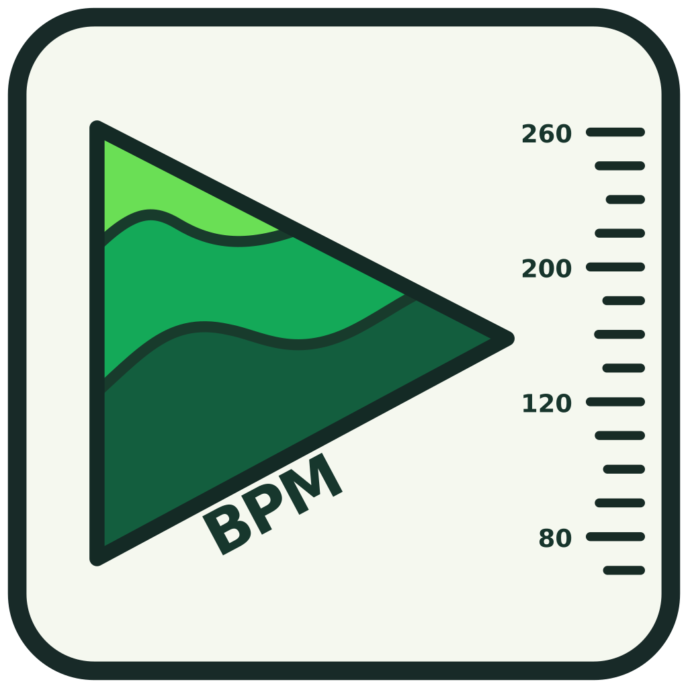

# BPM Player

**Your music. Your tempo.**

BPM Player is a free, open-source music player for Android, built for dancers,
dance teachers, DJs and anyone who needs precise tempo control while listening
to their own music. Adjust playback speed while keeping the original pitch,
inspect tempo information, practise sections with A–B loops, and organise a
local music collection without uploading files to a server.

> **Release status:** pre-release / on-device testing. Google Play
> internal testing preparation uses API 36, NDK r28c, 16 KiB native checks
> and a separately published GPL corresponding-source release.
> See [Play release readiness](docs/PLAY_RELEASE_READINESS.md).

## Features

| Feature | What it does |
| --- | --- |
| **High-quality time stretching** | Rubber Band R3 is the default audio engine; adjust speed from **0.25× to 1.50×** without intentionally changing musical pitch. |
| **BPM awareness** | Read BPM from filenames, estimate it from decoded audio, tap a tempo or enter a manual correction. Compare filename/detected/manual results. |
| **Waveform and looping** | Seek along a zoomable waveform, set A–B loop points, and jump ±10 seconds. |
| **Local library** | Select a folder with Android's Storage Access Framework (SAF); recursively scan supported tracks and cache the library for fast next starts. |
| **Playlists and Queue** | Create, rename, reorder and shuffle saved playlists; navigate tracks with Previous/Next and Stop/Next/Repeat modes. |
| **Background playback** | Music continues through the Android MediaSessionService with notification, lock-screen and headset transport controls. |
| **File tools** | Rename with BPM, scroll to the current song, remove a file (with confirmation) or move it to a user-selected exclusion folder. |

BPM detection is an **estimate**, particularly with swing, jazz and complex
rhythms. Tempo adjustments can affect audio quality on some devices; the
most useful range for dance sets is approximately 0.80×–1.10×.

## Getting started

1. Install the app on an Android phone and open **Library**.
2. Tap **Choose folder** and grant access to your music folder.
3. Tap a track to play it. Switch to **Player** to control tempo, waveform,
   BPM, A–B looping and track-end behavior.
4. Create and order playlists in **Playlists**; view the active sequence in
   **Queue**. **Current** scrolls to the currently playing track.
5. Use **Rescan** when files have changed outside the app.

The app reads local files via Android's SAF. It does **not** need broad
"all files" access to your phone. If an audio folder is removed or its
permission is revoked, select it again.

### Excluding or deleting tracks

Long-press a Library entry to open **Add to playlist**, **Rename with BPM**,
**Exclude from library** or **Delete**.

- **Exclude**: choose the exact destination directory using Android's file
  picker; e.g. if the library is `Music/jazz/`, choose `Music/excluded/`
  directly. Reuse or change the remembered folder at any time. The app copies
  and SHA-256-verifies the audio **before** deleting the original. If the
  storage provider reports a failure, the source is retained.
- **Delete**: removes the audio file from storage only after explicit
  confirmation. It is not merely a Library hide action; check your
  storage provider's trash/deletion behavior.

After successful removal, the file's Library/BPM/waveform caches and saved
playlist references are updated. **Test destructive actions using disposable
copies first.** See [Library file-management guide](docs/LIBRARY_FILE_OPERATIONS.md).

## Build from source

### Requirements

- **Android Studio**, **JDK 17** and **Android SDK 36** (target API 36).
- **Android NDK r28c (28.2.13676358)** (Side by side) and **CMake**
  for Rubber Band R3 and 16 KiB page-compatible native builds.
- A connected **Android 8.0+ (API 26+)** device or emulator. The initial
  native R3 build targets **arm64-v8a** only.
- Git and an internet connection for the initial download of the pinned
  Rubber Band source code.

From the repository root in Windows PowerShell:

```powershell
# Download the exact upstream Rubber Band 4.0.0 source (once).
.\tools\dsp\prepare-rubberband.ps1

# Debug APK + JVM unit tests (R3 by default).
.\gradlew.bat :app:assembleDebug :app:testDebugUnitTest
```

Open the root folder in Android Studio and run the `app` configuration.
The debug APK is generated at `app/build/outputs/apk/debug/app-debug.apk`.

For the previous Media3/Sonic audio engine, omit the native dependency by
passing `-Prubberband=false`:

```powershell
.\gradlew.bat :app:assembleDebug -Prubberband=false
```

GitHub Actions is **manual-only** and does not automatically build commits
or pull requests.

### Signed release and Google Play testing

To make a release, keep your signing key **private and backed up**. The
local release helper supports a signed APK or a Play Console upload AAB:

```powershell
.\tools\release\create-keystore.ps1   # Run only once.
.\tools\release\build-release.ps1 -Bundle
```

The script embeds the exact source revision in the application and produces
a **matching corresponding-source ZIP** containing the pinned native
Rubber Band sources. The ZIP still needs to be made available to recipients
under the applicable GPL conditions **before** distributing R3 binaries.

Read the [Play release checklist](docs/PLAY_RELEASE_READINESS.md),
[signed-release instructions](docs/10B-signed-release.md) and the
[open-source source/licence checklist](docs/OPEN_SOURCE_RELEASE.md).
The source-only GitHub Release may be published **before** the Play
developer account is approved, but it must match the eventual AAB revision.

## Project structure

| Location | Contents |
| --- | --- |
| `app/src/main/java/com/wombatriy/androidplayer/player/` | Playback model, queues and audio engine |
| `app/src/main/java/com/wombatriy/androidplayer/bpm/` | BPM estimation, tap tempo and local metadata |
| `app/src/main/java/com/wombatriy/androidplayer/waveform/` | Waveform decoding, rendering coordination and cache |
| `app/src/main/java/com/wombatriy/androidplayer/library/` | SAF scanning, cache, rename and file operations |
| `app/src/main/java/com/wombatriy/androidplayer/playlists/` | Ordered playlists and queue synchronization |
| `app/src/main/java/com/wombatriy/androidplayer/ui/` | Player, Library, Playlists and Queue screens |
| `branding/` | Editable launcher art, Play Store visual assets and descriptions |
| `tools/dsp/`, `tools/release/` | Pinned upstream source preparation and signed releases |

## Licence

BPM Player's original source code and contributor-owned artwork are
licensed under **GPL-3.0-or-later**. Rubber Band retains its original
**GPL-2.0-or-later** licence (used under its GPLv3 option for the combined
application), while AndroidX, Media3 and Kotlin retain their own licences.

See [LICENSE](LICENSE), [third-party notices](THIRD_PARTY_NOTICES.txt),
[copyright notes](legal/COPYRIGHT.md) and
[corresponding-source requirements](docs/OPEN_SOURCE_RELEASE.md).
You can also read bundled licence documents via the app's **ⓘ About &
licences** control.

## Development

See [ROADMAP.md](ROADMAP.md) for planned work and completed milestones.
Earlier implementation notes are archived in
[docs/DEVELOPMENT_HISTORY.md](docs/DEVELOPMENT_HISTORY.md).

Contributions and bug reports are welcome; please include the Android
version, phone model, playback speed, audio format and reproduction steps
when reporting audio issues.

## Library search

Tap the magnifying glass just after **Current** in Library. With an empty
query, the search window lists tracks marked **D** (automatically detected
as the active BPM source) first; other tracks follow in their normal Library
order. Type part of a filename for a case-insensitive `contains` search
without source-based ranking. Tap a result to close the search and scroll
Library to that track (like Current), **without starting playback**. The
underlying sorted Library and playback queue are unchanged. Results use the
already loaded BPM snapshot, so no filesystem or decoding work is performed.
